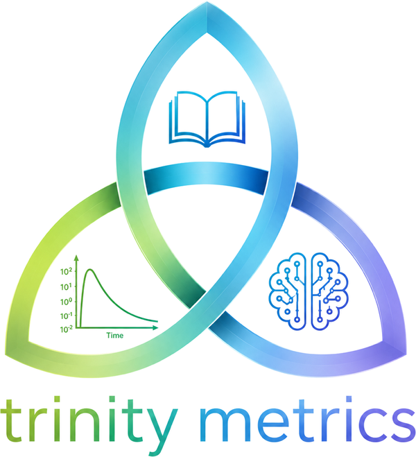
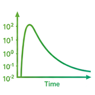

:::::: {.home}

::::: {.home-hero}

{.home-hero-logo fig-alt="A triquetra of three interlocking loops: a pharmacokinetic time course, an open book, and a brain drawn as a circuit. Wordmark: trinity metrics."}

TrinityMetrics combines a lifetime love of teaching and learning, 17 years of pharmacometrics experience, and a recent interest in using GenAI tools to support both education and drug development. The material on this site is organized into three categories:
:::::

::::: {.home-legs}

:::: {.home-leg .leg-pmx}

{.leg-icon}

## Pharmacometrics {.leg-title}

Tools, guides, checklists and talks I've developed and contributed to, that support model-informed drug development.

- [PMX Tools](pmx-tools.qmd)
- [Talks](talks.qmd)
- [Ongoing Projects](projects/index.qmd#pharmacometrics-methods)

::::

:::: {.home-leg .leg-edu}

{.leg-icon}

## Education {.leg-title}

Guides for learning and career development.

- [Learning Guides](guides/index.qmd)
- [Tutorials](talks.qmd#tutorials)

::::

:::: {.home-leg .leg-genai}

{.leg-icon}

## GenAI {.leg-title}

Project development using GenAI, skill files to support development, and a nascent blog.

- [Ongoing Projects](projects/index.qmd#genai)
- [Blog](blog/index.qmd)

::::

:::::

::::::
